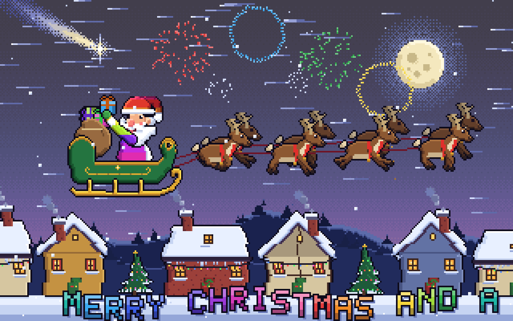
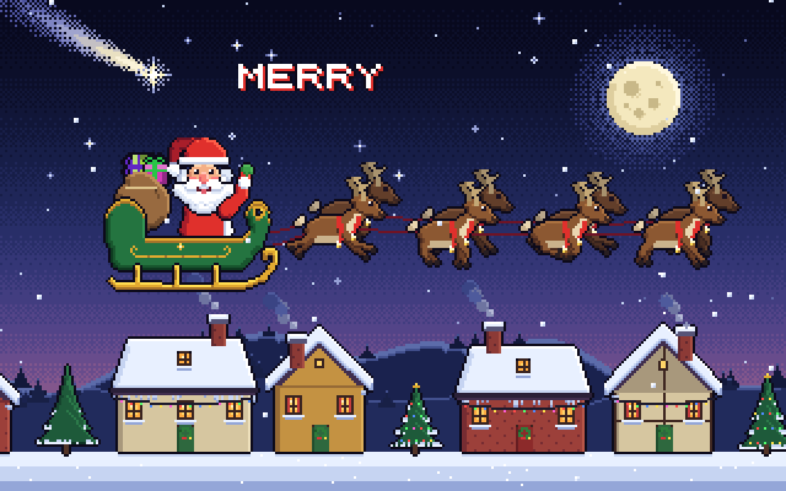
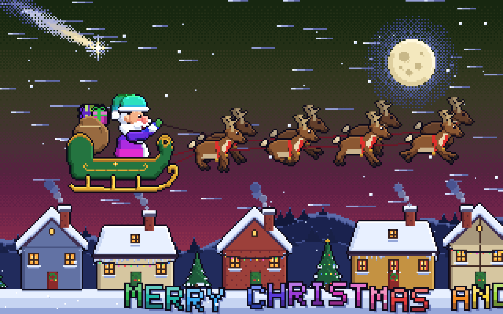
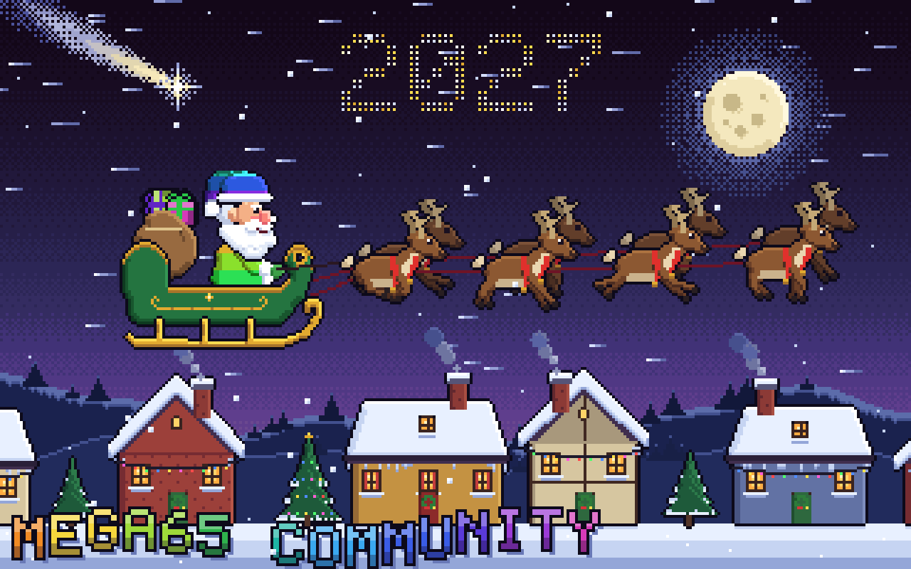

# crazy-santa

Santa on his sleigh over a snowy village, the eight reindeer in a flying gallop, Jingle Bells on the
four SIDs, and a show. A short, silly Christmas piece for the MEGA65.

He turns to you, grins, says HO HO HO in a deep voice, throws a present down a chimney, shakes the
reins and hiccups, all on the beat; every second time round he waves and wishes you a MERRY
CHRISTMAS. Then the music drops into its chip version and the picture goes with it: the stars fly
past as streaks, the sky sweeps through the spectrum, Santa's coat rolls through the rainbow and the
wishes scroll along the street. In the third part fireworks burst over the village on the kicks,
golden willows hang over the breakdown, and on the last bar a rocket's sparks fly into 2027. Then
the night is quiet again and it all comes round: 92 seconds a pass, for as long as you let it run.

Merry Christmas and a Happy New Year 2027 to the MEGA65 Community.

Version 1.0, 12 November 2026.

A 100-second video, with sound: [docs/crazy-santa.mp4](docs/crazy-santa.mp4). The first pass whole,
then the first bars of the second, where 2027 falls from the sky.

## Run

Needs a MEGA65 with its attic RAM, in PAL (50 Hz): the music and the picture count PAL's raster
lines. The program checks both and says what is missing; the Freezer menu switches a machine set to
NTSC to PAL.

1. Download `CRAZY-SANTA.D81` from the [latest release](https://github.com/psincosoft/crazy-santa/releases/latest)
   and copy it to the SD card.
2. `MOUNT "CRAZY-SANTA.D81"`
3. `LOAD"*",8,1`, then `RUN`

The disk's SHA-256: `369dd93385049811853027b170214a104ec58366ba846266df15cf145efa4e3b`.

The opening card, then the loading screen: the scene's first picture, still, while the files load
and the MEGA65 works out Santa's voice. Then it starts by itself. While it runs it borrows the
memory of the ROM's copy (the hypervisor lifts its protection) and of BASIC's variables, and puts
everything back when it ends. If the hypervisor refuses, the scene runs without the voice, the
streaks, the wishes and the fireworks, and says so at the end.

## Keys

No key is needed.

| Key | What it does |
|---|---|
| M | all sound off and on, the music and the voice; the picture keeps the music's time |
| Q or RUN/STOP | the end: BASIC's screen as it was, and the credits |

`TYPE "CREDITS"` shows the full credits from the disk.

## What is in it

- **The picture.** Pixel art in 252 colours, 320 x 200, every pixel drawn by our own code for the
  MEGA65's palette. It is not a bitmap: the VIC-IV's raster rewrite buffer builds it each frame from
  layers, 230 character tokens a row: the sky, the stars, the moon, the far hills, the village,
  the chimneys' smoke, 70 snowflakes, eight reindeer, the sleigh, the ropes and the reins, Santa in 38
  poses and his words in the air, each layer at its own speed, 50 frames a second.
- **The music.** Jingle Bells in two arrangements of our own, played by our Music Engine on the four
  SIDs from the raster interrupt, four ticks a frame: the plain chorus first, then the chip
  variation's two, with arpeggio chords, hard restarts, pulse-width sweeps and a filter on every SID.
- **The voice.** HO HO HO and MERRY CHRISTMAS are not a recording. A model of the vocal tract, a tube
  of ten sections after Kelly and Lochbaum (1962), works the voice out on the MEGA65 each time the
  program starts; the audio DMA plays it on the beat, beside the SIDs.
- **The show.** Everything follows the arrangement's own kicks, snares and crashes. The palette: the
  sky through the spectrum from red to violet, flashes, the moon's halo on the kick, Santa's rainbow.
  The warp: the stars as streaks, drawn by the CPU into a canvas of characters behind the beam. The
  wishes: letters as the rewrite buffer's sprites, bobbing, in the presents' hues. Fireworks: rockets,
  peonies, rings, golden willows and a barrage, up to 773 pixels of sparks a frame. A ripple through
  the village's rows on the snare rolls, the whole picture shaking on the big hits, and 2027 in 240
  sparks on the last bar.
- **Round and round.** The set loops and the show with it, for as long as the machine is on: each
  pass ends in the 2027, which falls through the first bar of the next.

## Pictures

The pictures and the video are made on a PC from the model of the picture that the program is built
from: in our tests the engine, run in a 6502 emulator with a model of the VIC-IV's raster rewrite
buffer, shows that picture pixel for pixel, frame by frame. The sound is the same writes to the SIDs
played through an emulated 6581 (reSIDfp), with the voice from the same tube model. They are not
photographs of the machine.

## Tested on

A MEGA65 (R6A) in PAL, core 890-sdcard-native build #63 (commit 1c737937), ROM 920422.

## Credits

crazy-santa 1.0, 2026, by Dawid Blachowski, with Claude, Anthropic's AI.
psinco. A Software Atelier from Luxembourg.

- Written with Claude, Anthropic's AI, which wrote the code, drew the pictures, arranged the music
  and shaped the voice under Dawid Blachowski's direction.
- Jingle Bells: James Lord Pierpont, registered in 1857 as "The One Horse Open Sleigh", in the public
  domain. The chorus as it is sung today is a later change by an unknown hand, on record since 1898.
  Both arrangements are our own; nobody's arrangement or recording is used.
- The eight reindeer are those of the poem "A Visit from St. Nicholas", 1823.
- The voice: a tube of ten sections after J. L. Kelly Jr. and C. C. Lochbaum, Speech synthesis,
  Fourth International Congress on Acoustics, Copenhagen, 1962; the vowels fitted to G. E. Peterson
  and H. L. Barney, JASA 24 (1952); the glottal pulse after A. E. Rosenberg, JASA 49 (1971). The
  full references are in the disk's CREDITS file.
- The letters of Santa's words and of the wishes are our own.
- Made with Python, NumPy, SciPy, Pillow, py65 and d64; the video with FFmpeg and reSIDfp.

## Terms

crazy-santa is free, under the MIT licence: see [LICENSE](LICENSE). Its source code is not
published.
